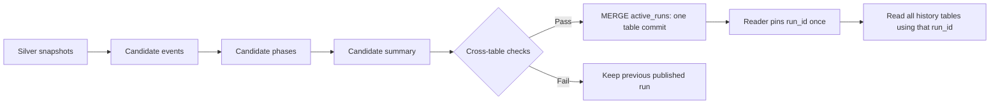

# ทดลองเผยแพร่ Gold เป็นชุดที่สอดคล้องกัน

โจทย์: events, phases และ summary อยู่คนละ Iceberg table การเขียนสำเร็จ
ในตารางหนึ่งไม่ได้ทำให้ทุกตารางเปลี่ยนพร้อมกัน และ `DELETE` แล้ว `INSERT`
ยังทำให้เกิดช่วงที่ข้อมูลเที่ยวบินหายระหว่างสอง commit

การทดลองนี้ใช้ Trino 483, Iceberg REST catalog, RustFS และ Dagster ที่มีอยู่
ใช้ flight sample จริงที่อยู่ใน `decoded/` แต่กฎแบ่ง phase ยังเป็นกฎ PoC
สร้างสอง schema แยกจาก `iceberg.gold` เดิม:

| Schema | หน้าที่ |
|---|---|
| `gold_publication_baseline` | ทำ DELETE/INSERT ตามลำดับเดิม เพิ่ม run_id เพื่อสังเกตแต่ละรุ่น |
| `gold_publication` | เก็บ candidate หลายรุ่นและ pointer ของรุ่นที่เผยแพร่ |

## Design



1. อ่าน snapshot ID ของ Silver ที่ใช้ หลังโหลด Silver ของเที่ยวบินเสร็จ
2. สร้าง UUID `run_id` ใหม่ และจำ active run เดิม
3. เขียน events/phases/summary แบบ append โดยทุกแถวใช้ run_id เดียวกัน
4. phases และ summary อ่านเฉพาะ candidate ของตนเอง ไม่อ่าน serving views
5. ตรวจจำนวนและลำดับ event, phase gaps/overlaps, ความสอดคล้องของ boundaries,
   recording coverage, segmentation delta และ summary กับ events/phases
6. `MERGE` pointer ของเที่ยวบินใน `active_runs` เมื่อผ่านครบเท่านั้น
7. ถ้างานล้ม ผลเก่าที่เผยแพร่ยังอ่านได้ ส่วน candidate ที่ค้างไม่ถูกเสิร์ฟ

นี่เป็น publication protocol ไม่ใช่ distributed transaction ครอบทุกตาราง
ความถูกต้องขึ้นกับการไม่แก้ candidate ที่เผยแพร่แล้ว และ contract ของ reader

## รันทดลองทั้งหมด

จาก terminal:

```bash
cd /Users/preem/4term1/capstone/trino-iceberg-poc
conda activate qar-poc
docker compose up -d
python publication_experiment.py --hold-seconds 0.5
```

หาก Silver ของเที่ยวบินนี้ยังไม่มี script จะสร้าง schema จาก DDL เดิม
และโหลด recording ตัวอย่างให้ ถ้ามีแล้วจะใช้ข้อมูลเดิมและไม่ reload
รอ Trino พร้อมรับ query ก่อนเรียก script

ผลแต่ละรอบอยู่ใน `results/publication/<UTC timestamp>/`:

- `evidence.json`: checkpoints, concurrent reads, run IDs, input snapshots,
  elapsed times, file/snapshot metrics และผล assertions
- `report.md`: ตารางผลสำหรับอ่านและนำไปอัปเดต

### สิ่งที่ทดลองจริง

| กรณี | สิ่งที่ตรวจ |
|---|---|
| Baseline สำเร็จ | อ่านหลัง DELETE และหลัง INSERT ทุกตาราง รวม reader thread ระหว่างเขียน |
| Baseline หยุดหลัง events | phases/summary รุ่นเก่ายังค้างอยู่กับ events รุ่นใหม่ |
| Publication สำเร็จ | ระหว่างสร้าง candidate ยังเห็นชุดเดิม; เปลี่ยน pointer หลังครบ |
| Candidate ไม่ครบ | publish ถูกปฏิเสธ |
| Candidate ครบแต่ summary ผิด | semantic validation ปฏิเสธ |
| Candidate สร้างจาก active run เก่า | ไม่ให้ publish ทับ release ใหม่ที่เข้ามาแล้ว |
| Reader pin รุ่นเก่า | ยังอ่านรุ่นเดิมได้หลังเผยแพร่รุ่นใหม่ |
| อ่าน serving views คนละเวลา | แสดงว่าสามารถข้าม release ได้ จึงต้อง pin สำหรับหลาย query |
| Dagster สำเร็จ | รัน asset graph และ blocking check จริง |
| Dagster ล้มหลัง events | ไม่รัน publish และชุดเดิมยังครบ |
| Dagster retry | สร้าง candidate UUID ใหม่และเผยแพร่สำเร็จ |

script เว้นช่วงหลังแต่ละ checkpoint เพื่อให้ reader เห็น commit boundaries
จึงไม่ควรใช้ elapsed time หรืออัตรา missing/mixed เป็น production benchmark
missing และ mixed เป็นคนละเงื่อนไขและสามารถเกิดใน read เดียวกันได้

## เปิดดูใน Dagster

ใช้ instance แยกจาก demo เดิมเพื่อดูงานทดลอง:

```bash
cd /Users/preem/4term1/capstone/trino-iceberg-poc
conda activate qar-poc
mkdir -p publication_dagster_home
export DAGSTER_HOME="$PWD/publication_dagster_home"
dagster dev -f publication_pipeline.py --port 3001
```

เปิด `http://localhost:3001` เลือก job `publish_flight` ใน Launchpad ใส่ config:

```yaml
ops:
  candidate_input:
    config:
      recording: A350_HS-THJ_20220322_TG0341_VTBS-OPKC
      cruise_seconds: 300
  candidate_phases:
    config:
      simulate_failure: false
```

เปลี่ยน `simulate_failure: true` เพื่อทำให้งานหยุดหลัง events
ตรวจใน Trino ว่า active run ไม่เปลี่ยน และ serving tables ยังอ่านครบ
จากนั้นรันใหม่ด้วย `false` จะสร้าง candidate ใหม่ ไม่มีการ reuse run_id ที่ค้าง

job ใช้ in-process executor กับ memory IO manager สำหรับ PoC
จึงควรรัน asset graph ทั้ง job; ไม่ใช่ระบบ resume ข้าม process จาก asset กลางทาง
การรันใน experiment ใช้ ephemeral Dagster instance และเก็บ run IDs ใน evidence
ถ้าต้องการดูประวัติผ่าน UI ให้รัน job จาก Launchpad ของ instance ด้านบน

## อ่านข้อมูลอย่างถูกต้อง

ดู current release:

```sql
SELECT flight_id, run_id, previous_run_id, cruise_seconds, published_at
FROM iceberg.gold_publication.active_runs;

SELECT flight_id, run_id, phase, start_s, end_s
FROM iceberg.gold_publication.flight_phases
ORDER BY flight_id, phase_order;
```

สำหรับ dashboard/report ที่อ่านหลาย SQL statements ให้ resolve pointer ครั้งเดียว:

```sql
SELECT run_id FROM iceberg.gold_publication.active_runs
WHERE flight_id = 'HS-THJ_20220322T111310_F01';
```

นำ run_id ที่ได้ส่งไปทุก query ด้านล่าง แทน `<PINNED_RUN_ID>`:

```sql
SELECT * FROM iceberg.gold_publication.flight_events_history
WHERE flight_id = 'HS-THJ_20220322T111310_F01'
  AND run_id = '<PINNED_RUN_ID>' ORDER BY t_offset_s;

SELECT * FROM iceberg.gold_publication.flight_phases_history
WHERE flight_id = 'HS-THJ_20220322T111310_F01'
  AND run_id = '<PINNED_RUN_ID>' ORDER BY phase_order;

SELECT * FROM iceberg.gold_publication.flight_summary_history
WHERE flight_id = 'HS-THJ_20220322T111310_F01'
  AND run_id = '<PINNED_RUN_ID>';
```

serving views สะดวกสำหรับ query เดี่ยว แต่การอ่านสาม view แยกกันแล้วมี publish
คั่นระหว่าง query อาจได้คนละ run_id จึงไม่ได้แก้ปัญหาด้วย views อย่างเดียว

## ขอบเขตของข้อสรุป

- ทดสอบกับ A350 recording หนึ่งเที่ยวบินใน local stack
- กำหนดให้มี publisher หนึ่งตัวต่อเที่ยวบิน `active_runs` ไม่มี enforced unique key
  การเช็ก previous_run_id ลด stale publication แต่ยังไม่ใช่หลักฐานรองรับ writer แข่งกัน
- pin Silver snapshot แยกแต่ละตาราง หลัง Silver loader เสร็จ
  ยังไม่รองรับการ reload เที่ยวบินเดียวกันพร้อมกับสร้าง candidate
- ต้องเก็บ candidate ที่เผยแพร่แล้วไว้ขณะมี reader pin อยู่; ยังไม่มี retention/GC
- candidate ที่ไม่เผยแพร่และผลเก่าทำให้ storage โต เป็น tradeoff ที่ต้องจัดการต่อ
  จำนวนรอบ failed/stale tests ของสอง protocol ต่างกัน จึงเทียบ storage หลังรอบนี้
  เพื่อสรุปว่า protocol ไหนประหยัดกว่าไม่ได้
- baseline เพิ่ม run_id เพื่อ instrument รุ่น; ใช้กฎ Gold เดิมและ commit sequence เดิม
- ยังไม่มี OPA/authentication ใน stack นี้ การควบคุมสิทธิ์เข้าถึง history tables
  และ serving views เป็นงานถัดไป
- `QAR_TRINO_HOST`, `QAR_TRINO_PORT`, `QAR_TRINO_USER` ใช้เปลี่ยน connection ของการทดลองได้

## ประโยคสำหรับอัปเดต

> ทดลองการ rebuild Gold ที่ประกอบด้วย events, phases และ summary หลายตาราง
> พบว่าวิธี DELETE/INSERT แยกตารางทำให้ผู้ใช้อ่านข้อมูลไม่ครบหรือคนละรุ่นได้
> จึงทดลองเก็บผลตาม run_id ตรวจความสอดคล้อง แล้วเผยแพร่ด้วย pointer เดียว
> เมื่อ Dagster ล้มระหว่างทาง ผู้ใช้ยังอ่านชุดเดิมที่ครบได้
> สำหรับรายงานที่อ่านหลาย query ต้อง pin run_id เดียวตลอดการอ่าน
